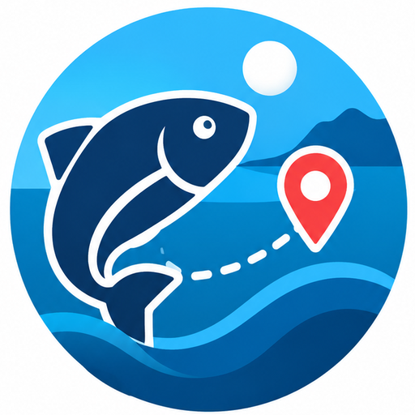

  

<h1 align="center">FishTrack 🐟</h1>

  <strong>Tu compañero de pesca</strong> 
  Registra tus capturas, consulta estadísticas y guarda tus lugares favoritos.

No se incluye todavía ningún modelo de clasificación de peces. Consulta `docs/AI-ROADMAP.md` antes de añadir pesos: verifica licencia, taxonomía, compatibilidad Android y evaluación con especies de España. No coloques aquí pesos descargados sin revisar sus condiciones.
