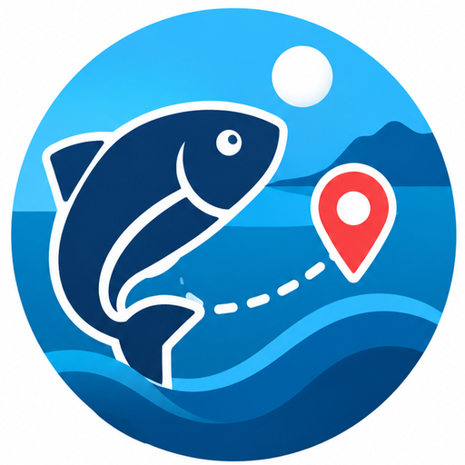

  

<h1 align="center">FishTrack 🐟</h1>

  <strong>Tu compañero de pesca</strong> 
  Registra tus capturas, organiza tus jornadas y descubre cómo evoluciona tu actividad de pesca.

**FishTrack** es una aplicación para llevar el control de tus aventuras de pesca, tanto en el mar como en ríos y pantanos. Guarda tus capturas con fotografías, conserva tus lugares favoritos, organiza tu equipo y consulta estadísticas de tus jornadas desde una sola aplicación.

## Características principales

- 🐟 **Registro de capturas:** añade peces manualmente, guarda sus datos y acompáñalos de fotografías.
- 📷 **Cámara y galería:** haz una foto o selecciónala desde el móvil. Al editar un registro compatible puedes añadir, cambiar o eliminar su fotografía.
- 📅 **Jornadas de pesca:** crea salidas, consulta sus detalles, edítalas, finalízalas o elimínalas. También puedes guardar jornadas en las que no hayas conseguido capturas: ¡esas salidas también cuentan!
- 📊 **Estadísticas de jornadas:** consulta el total de salidas, cuántas terminaron con capturas y cuántas sin ellas, además de las capturas vinculadas.
- 🗺️ **Mapa:** guarda y consulta puntos de pesca, favoritos y registros que tengan coordenadas.
- 🎒 **Material de pesca:** organiza cañas, carretes, señuelos y accesorios.
- 🗓️ **Planificación:** prepara futuras jornadas y organiza tus salidas.
- 🌙 **Calendario lunar:** consulta las fases de la Luna como orientación para tus jornadas.
- 📄 **Licencias:** guarda tus licencias de pesca en PDF.
- 🌦️ **Meteorología:** consulta información del tiempo para preparar tus salidas.
- 🌍 **Español e inglés:** interfaz disponible en ambos idiomas.

## Gratis, sin registro y de código abierto

FishTrack no requiere crear una cuenta ni registrarse. Tus datos se guardan localmente en tu dispositivo. No necesitas una suscripción para utilizar la aplicación.

**Tu pasión, tus capturas y todas tus jornadas — con pez o sin él — en un mismo lugar.**

¡Que cada jornada cuente! 🎣

## Actualizaciones y conservación de datos

- Instala las nuevas versiones **encima de la versión existente**. No desinstales FishTrack ni borres sus datos: las capturas, fotos y ajustes se guardan en el almacenamiento privado de la aplicación.
- Se mantiene el identificador Android `org.fishtrack.app` para que Android reconozca la actualización como la misma aplicación.
- Las APK de actualización deben estar firmadas siempre con la misma clave privada. GitHub Actions ahora exige la clave permanente configurada en los secretos del repositorio y detiene la compilación si falta; así evita ofrecer una APK firmada temporalmente que Android no pueda instalar encima de la anterior.
- Antes de actualizar, crea una copia desde el apartado de copias de seguridad y guárdala fuera del móvil. La copia incluye los registros y ajustes almacenados en WebView y, en Android, los PDF de licencias guardados en el almacenamiento privado. La restauración de los PDF está disponible en esta versión 3.3.3 y posteriores.
- Para cambiar de una instalación firmada con otra clave, exporta primero la copia desde la aplicación antigua, instala la nueva APK firmada con la clave permanente e importa la copia. No desinstales la versión antigua hasta comprobar que el archivo JSON se ha guardado correctamente. Si no conservas la clave original, Android no permitirá instalar la APK nueva encima de la antigua.

## Versión 3.3.3

Esta versión amplía la copia de seguridad para incluir todas las claves de almacenamiento local y los PDF de licencias guardados en Android, además de los registros de capturas, material, amistades, puntos, jornadas, planificaciones, listas y retos. La restauración recupera los registros y vuelve a cargar la aplicación para que los datos importados aparezcan correctamente.

> **Nota:** FishTrack no incorpora todavía un modelo de clasificación automática de peces. Consulta `docs/AI-ROADMAP.md` antes de añadir modelos o pesos de terceros: comprueba su licencia, taxonomía, compatibilidad con Android y evaluación con especies de España.

## Compilar la aplicación

El proyecto incluye un flujo de GitHub Actions para compilar el APK. Puedes consultar las ejecuciones y descargar los artefactos disponibles desde la pestaña **Actions** del repositorio.
